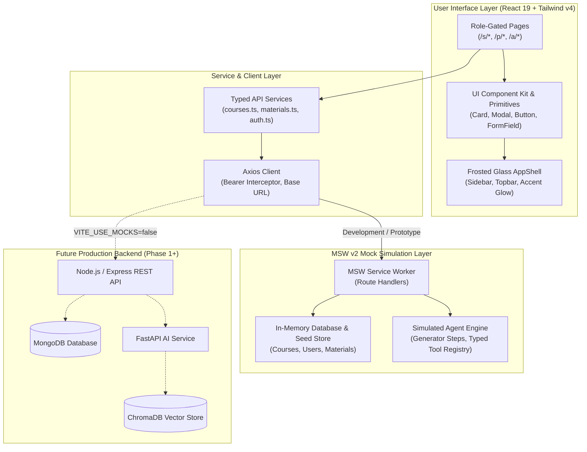
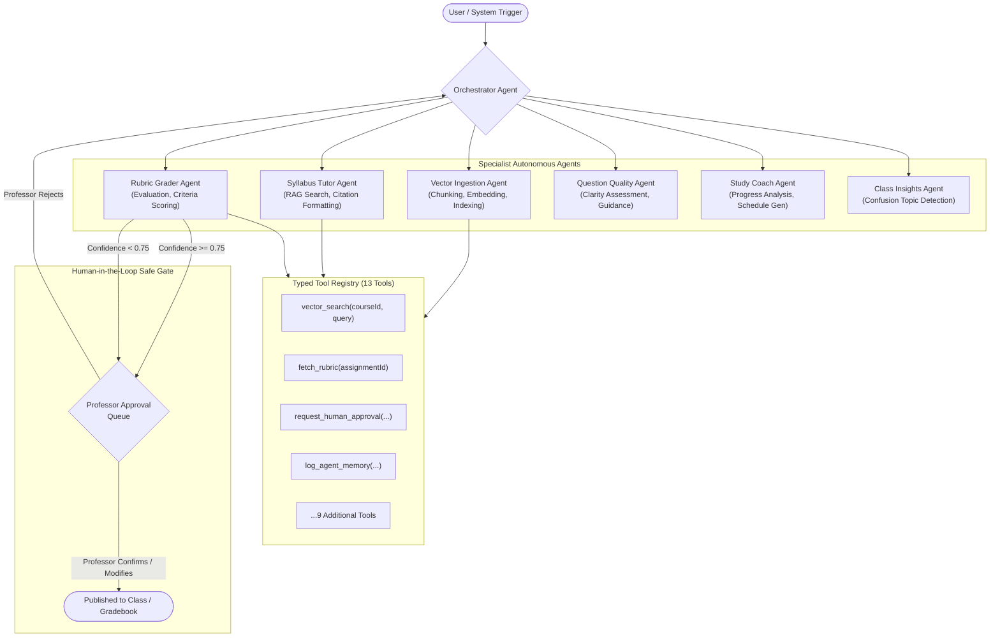
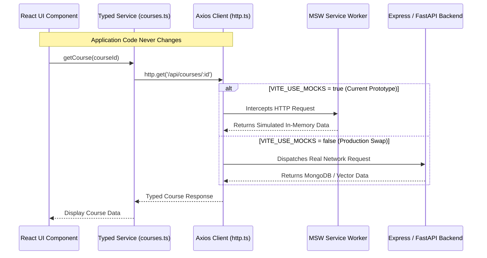

# 🎓 AiCademy · Agentic AI Digital Classroom

<div align="center">

[](https://www.typescriptlang.org/)
[](https://react.dev/)
[](https://vitejs.dev/)
[](https://tailwindcss.com/)
[](https://mswjs.io/)
[](https://vitest.dev/)
[](https://www.w3.org/WAI/standards-guidelines/wcag/)
[](LICENSE)

<br/>

<p align="center">
  <strong>An intelligent, agentic digital classroom platform for higher education.</strong><br>
  Unifying university course management with autonomous, tool-calling AI specialist agents that tutor students, evaluate submissions against grading rubrics, and assist professors—governed strictly by human-in-the-loop safety gates.
</p>

[Quick Start](#-quick-start) • [Live Demo Personas](#-demo-personas--1-click-switcher) • [Architecture](#%EF%B8%8F-system-architecture) • [Agent System](#-agentic-intelligence-layer) • [Design System](#-solid--frosted-glass-design-system) • [Testing](#-testing--quality-assurance)

</div>

---

## 📑 Table of Contents

- [Overview](#-overview)
  - [The Problem](#the-problem)
  - [The AiCademy Solution](#the-aicademy-solution)
- [Key Features](#-key-features)
  - [1. Student Workspace](#1-student-workspace-s)
  - [2. Professor Studio](#2-professor-studio-p)
  - [3. Platform Administration](#3-platform-administration-a)
- [System Architecture](#%EF%B8%8F-system-architecture)
  - [Multi-Tier Layering](#multi-tier-layering)
  - [Directory Structure](#directory-structure)
- [Agentic Intelligence Layer](#-agentic-intelligence-layer)
  - [Specialist Agents Topology](#specialist-agents-topology)
  - [Typed Tool Registry](#typed-tool-registry-13-tools)
  - [Human-in-the-Loop Safety Principles](#human-in-the-loop-safety-principles)
- [Solid & Frosted Glass Design System](#-solid--frosted-glass-design-system)
  - [12 Dynamic Accent Presets](#12-dynamic-accent-presets)
  - [4px Baseline Spacing Scale](#4px-baseline-spacing-scale)
  - [WCAG AA Accessibility Standards](#wcag-aa-accessibility-standards)
- [Quick Start](#-quick-start)
  - [Prerequisites](#prerequisites)
  - [Local Installation](#local-installation)
  - [Environment Configuration](#environment-configuration)
- [Demo Personas & 1-Click Switcher](#-demo-personas--1-click-switcher)
- [Interactive Demo Walkthrough](#-interactive-demo-walkthrough)
- [Testing & Quality Assurance](#-testing--quality-assurance)
- [Backend Swap Guide](#-backend-swap-guide)
- [Roadmap & Milestone Status](#%EF%B8%8F-roadmap--milestone-status)
- [Project Governance & Memory](#-project-governance--memory)

---

## 🌟 Overview

### The Problem
Traditional Learning Management Systems (LMS) are passive repositories: static file trees, manual grading queues, and siloed forum threads. While generative AI chatbots offer quick answers, ungrounded single-shot LLM wrappers hallucinate facts, lack syllabus awareness, expose students to prompt injection, and risk academic integrity by auto-publishing unverified grades.

### The AiCademy Solution
**AiCademy** replaces passive management and unreliable chatbots with an **Agentic AI Architecture**. Specialized autonomous agents plan multi-step workflows, execute strictly typed tools within isolated course scopes, verify facts against vector-indexed course syllabi, and reflect on outputs. Most importantly, all high-stakes actions (grade finalization, public announcements) halt at **Human-in-the-Loop Approval Gates** until authorized by faculty.

```
┌────────────────────────────────────────────────────────────────────────┐
│                        AiCademy Platform Core                          │
├──────────────────────────┬─────────────────────────────┬───────────────┤
│    Academic Workspace    │     Agentic AI Services     │ Safety Rails  │
│  • Course Management     │  • Autonomous Orchestrator  │  • Human Gate │
│  • Material Management   │  • Vector Ingestion Agent   │  • Anti-Inject│
│  • Rubric Grading Engine │  • Syllabus-Grounded Tutor  │  • Role Scope │
│  • Doubt Clearing System │  • Rubric Grader & Insights │  • Audit Log  │
└──────────────────────────┴─────────────────────────────┴───────────────┘
```

---

## 🚀 Key Features

### 1. Student Workspace (`/s/*`)
- **Interactive Course Hub**: Browse enrolled courses, view real-time progress indicators, and inspect course syllabus materials.
- **6-Character Code Enrollment**: Instant course enrollment with automatic code lookup, duplicate enrollment prevention, and instructor preview.
- **Vector Ingestion Transparency**: Inspect how course PDFs and lecture slides are chunked, tokenized, and embedded into vector storage.
- **Syllabus-Grounded AI Tutor**: Ask technical course questions answered with verifiable document citations and confidence scoring.
- **Personalized Study Coach**: Adaptive study plans generated from assignment performance, pending deadlines, and identified knowledge gaps.

### 2. Professor Studio (`/p/*`)
- **Course Studio**: Create and configure university courses; generate and regenerate secure 6-character enrollment codes with one-click copying.
- **Drag-and-Drop Material Manager**: Upload PDFs, DOCX, PPTX, TXT, or MD files (up to 20MB) with client-side sanitization, format validation, and automated vector indexing.
- **Student Roster Management**: Real-time enrolled student list with performance tracking and enrollment date auditing.
- **Human-in-the-Loop Approval Inbox**: Review AI-evaluated assignment submissions with side-by-side rubric criteria scoring and professor overrides before publishing.
- **Announcement Studio**: Draft announcements with optional AI enhancement, subject to instructor sign-off before class broadcast.

### 3. Platform Administration (`/a/*`)
- **Observability Console**: Institution-wide visibility over total active courses, faculty, students, and active agent threads.
- **Agent Health & Cost Telemetry**: Track token consumption, model latencies, tool call success rates, and budget allocations.
- **Orchestrator Event Simulator**: Dispatch synthetic classroom events (`material.uploaded`, `submission.created`, `doubt.posted`) to observe multi-agent orchestration.

---

## 🏗️ System Architecture

### Multi-Tier Layering

AiCademy enforces strict architectural separation. Presentation components consume typed Axios services and never interface directly with mock data or storage engines.



### Directory Structure

```
AiCademy/
├── brain.md                      # Canonical project memory, handoff log & decision history
├── AGENTS.md                     # Agent instructions & pointer to memory
├── ROADMAP.md                    # Multi-phase engineering roadmap (Phases 0–8)
├── docs/
│   ├── ARCHITECTURE_SOURCE.md    # Verbatim original PDF specification (Part A)
│   ├── AGENTIC_DESIGN.md         # Verbatim Agentic design specification (Part B, EXTENSION)
│   └── UI_SPACING_AUDIT.md       # Comprehensive UI spacing audit & token standards
├── backend/                      # Reserved for Phase 1 Express API (README placeholder)
├── ai-service/                   # Reserved for Phase 3 FastAPI/ChromaDB (README placeholder)
└── frontend/                     # React 19 + TypeScript + Vite 8 Web Application
    ├── public/                   # Static assets & MSW mockServiceWorker.js
    ├── src/
    │   ├── auth/                 # AuthContext, RoleGuard, ProtectedRoute, JWT helpers
    │   ├── components/
    │   │   ├── layout/           # AppShell, Topbar, Sidebar, PageContainer, Section
    │   │   └── ui/               # Button, Card, Modal, FormField, ButtonGroup, StatCard
    │   ├── context/              # ThemeContext (dark/light), AccentContext (12 presets)
    │   ├── mocks/
    │   │   ├── browser.ts        # MSW worker initialization
    │   │   ├── db/               # Seed data, persistent store, UUID generator
    │   │   └── handlers/         # Auth, Courses, Materials, Assignments, Doubts
    │   ├── pages/
    │   │   ├── admin/            # AdminOverview & platform analytics
    │   │   ├── auth/             # Login, Register & DemoRoleSwitcher
    │   │   ├── common/           # Appearance Settings & profile
    │   │   ├── professor/        # ProfessorDashboard, ProfessorCourses, CourseDetail
    │   │   └── student/          # StudentDashboard, StudentCourses, CourseDetail
    │   ├── services/             # http.ts, auth.ts, courses.ts, materials.ts
    │   ├── test/                 # Vitest test suites (auth, courses, materials, jwt)
    │   ├── tokens/               # spacing.ts (4px baseline scale tokens)
    │   └── types/                # domain.ts (PDF models), agents.ts, api.ts
    ├── index.html                # Pre-paint theme & accent script (zero FOUC)
    ├── vite.config.ts            # Vite 8 configuration with Tailwind v4 & Vitest
    └── package.json              # Project dependencies & build scripts
```

---

## 🤖 Agentic Intelligence Layer

### Specialist Agents Topology

AiCademy utilizes a collaborative multi-agent architecture coordinated by a central Orchestrator. Agents operate via typed plans, tool invocations, observations, and reflection loops.



### Typed Tool Registry (13 Tools)

Every tool call is validated with strict **Zod** input/output schemas, logged with latency and token metrics, and constrained by **course scope**:

| Tool Identifier | Description | Required Authorization | Course Isolated |
|:---|:---|:---:|:---:|
| `vector_search` | Search semantic embeddings of indexed course materials | Student / Professor | Yes |
| `read_material_chunk` | Fetch exact text excerpt for verified citations | Student / Professor | Yes |
| `fetch_rubric` | Retrieve assignment grading rubric and criteria weights | Grader Agent | Yes |
| `evaluate_criterion` | Score submission excerpt against a single rubric item | Grader Agent | Yes |
| `request_human_approval`| Escalate sensitive action to instructor inbox | Any Agent | Yes |
| `read_student_history` | Retrieve past submissions, scores, and doubt patterns | Study Coach | Yes |
| `create_study_block` | Schedule recommended study session in user calendar | Study Coach | Yes |
| `draft_announcement` | Create draft broadcast message for instructor review | Insights Agent | Yes |
| `query_doubt_clusters` | Aggregate frequently asked questions and confusion areas | Insights Agent | Yes |
| `assess_question_clarity`| Evaluate student question quality before posting | Quality Agent | Yes |
| `reindex_document` | Trigger document re-parsing and embedding regeneration | Ingestion Agent | Yes |
| `read_agent_memory` | Retrieve long-term course or student context | Any Agent | Yes |
| `write_agent_memory` | Save synthesized insights to persistent memory store | Any Agent | Yes |

### Human-in-the-Loop Safety Principles

1. **No Autonomous Grade Publishing**: Grader agents output *provisional* evaluations labeled with confidence scores. Final marks enter the gradebook only when explicitly approved or overridden by a professor.
2. **No Autonomous Public Broadcasts**: Agent-generated announcements or mass emails are placed in a draft approval state.
3. **Strict Course-ID Partitioning**: A student or agent running in CS301 can never query or cross-reference vector embeddings or materials belonging to another course.
4. **Prompt Injection Defense**: Untrusted submission text or student doubts are parsed strictly as raw data payloads; the Critic loop flags adversarial instructions attempting to hijack agent prompts.

---

## 🎨 Solid & Frosted Glass Design System

The AiCademy interface incorporates a modern aesthetic based on the Quizlet design language elevated with **solid surfaces and frosted glass depth** (`backdrop-blur-xl`, `bg-surface/80-90`).

### 12 Dynamic Accent Presets

Users can customize their workspace with 12 vibrant accent color presets or choose a custom hex color:

| Accent Preset | Hex Code | Visual Swatch | Mood & Persona |
|:---|:---:|:---:|:---|
| **Iris Indigo** *(Default)* | `#4255ff` |  | Focused, academic, authoritative |
| **Ocean Blue** | `#2563eb` |  | Crisp, intellectual, serene |
| **Electric Cyan** | `#0891b2` |  | Modern, energetic, computational |
| **Deep Teal** | `#0d9488` |  | Sophisticated, balanced, natural |
| **Forest Emerald** | `#059669` |  | Vital, rewarding, clear |
| **Sunburst Amber** | `#d97706` |  | Warm, encouraging, high-visibility |
| **Sunset Coral** | `#ea580c` |  | Dynamic, vibrant, motivating |
| **Crimson Rose** | `#e11d48` |  | Bold, expressive, urgent |
| **Vivid Pink** | `#db2777` |  | Creative, playful, engaging |
| **Neon Fuchsia** | `#c026d3` |  | Futuristic, artistic, high-energy |
| **Amethyst Violet** | `#7c3aed` |  | Deep, imaginative, luxurious |
| **Royal Purple** | `#9333ea` |  | Regal, distinguished, scholarly |

- **Instant Propagation**: Changing the accent updates buttons, links, active nav items, focus rings, progress bars, and the AI badge with zero page reload.
- **Pre-Paint Script**: An inline `<head>` script retrieves `localStorage.getItem('aicademy.accent')` before DOM rendering, eliminating Flash of Unstyled Content (FOUC).
- **WCAG AA Contrast Calculation**: Text color on accent surfaces is automatically computed based on relative luminance (`#ffffff` for dark accents, `#0b0f19` for light accents).
- **Ambient Lighting Orbs**: Dynamic background light orbs derive color from `--accent-rgb`, creating authentic glass refraction through translucent card surfaces.

### 4px Baseline Spacing Scale

Every layout dimension adheres to a strict 4px mathematical scale defined in `src/tokens/spacing.ts`:

```
0.5 (2px)  •  1 (4px)  •  1.5 (6px)  •  2 (8px)  •  3 (12px)  •  4 (16px)
5 (20px)   •  6 (24px) •  8 (32px)   •  12 (48px) •  16 (64px)
```

- **Layout Grid**: Standard wrapper `px-4 sm:px-6 lg:px-8 py-6 sm:py-8 max-w-7xl mx-auto`.
- **Card Padding**: Standard `p-6`, compact `p-4`, hero banners `p-6 sm:p-8`.
- **Form Rhythm**: Label-to-input `mb-1.5`, input-to-error `mt-1.5`, field gap `space-y-4`.
- **Button Standards**: Mobile touch targets guaranteed &ge;44px tall (sm: 32px, md: 44px mobile / 40px desktop, lg: 48px).

### WCAG AA Accessibility Standards
- Keyboard navigable with prominent focus rings (`ring-2 ring-accent ring-offset-2`).
- Screen reader accessible with ARIA live regions and icon labels.
- Zero horizontal overflow on 375px mobile screens with smooth off-canvas navigation drawer.

---

## ⚡ Quick Start

### Prerequisites
- **Node.js**: `v20.0.0` or higher (tested on `v24.16.0`)
- **npm**: `v10.0.0` or higher (tested on `v11.13.0`)
- Modern Evergreen Browser (Chrome, Edge, Firefox, Safari)

### Local Installation

1. **Clone the repository**:
   ```bash
   git clone https://github.com/your-username/aicademy.git
   cd aicademy/frontend
   ```

2. **Install frontend dependencies**:
   ```bash
   npm install
   ```

3. **Start the Vite development server**:
   ```bash
   npm run dev
   ```
   The application will start at **`http://localhost:5173/`**.

4. **Run the automated test suite**:
   ```bash
   npx vitest run
   ```

5. **Build for production**:
   ```bash
   npm run build
   ```

### Environment Configuration

The application includes an environment template in `frontend/.env.example`:

```bash
# Set to 'true' to run with MSW mock API and in-memory database
VITE_USE_MOCKS=true

# Target API root when connecting to real backend services
VITE_API_BASE_URL=/api
```

---

## 👥 Demo Personas & 1-Click Switcher

For rapid exploration, a **Demo Role Switcher** is pinned to the Topbar on every screen and on the Login page:

| Persona | Role | Email | Password | Preloaded Data & Scenarios |
|:---|:---:|:---|:---:|:---|
| **Aarav Sharma** | Student | `student1@aicademy.dev` | `demo1234` | Enrolled in CS301 & CS220; active doubt threads |
| **Mei-Ling Zhou** | Student | `student2@aicademy.dev` | `demo1234` | Enrolled in CS301; high leaderboard standing |
| **Dr. Priya Rao** | Professor | `prof.rao@aicademy.dev` | `demo1234` | Lead instructor for CS301 & CS220; 5 materials |
| **Dr. Wei Chen** | Professor | `prof.chen@aicademy.dev` | `demo1234` | Lead instructor for AI410 Machine Learning |
| **Ada Okafor** | Admin | `admin@aicademy.dev` | `demo1234` | Institution-wide platform telemetry & run logs |

*All 8 pre-seeded student accounts use password `demo1234` (`student1` through `student8`).*

---

## 🎯 Interactive Demo Walkthrough

Follow these steps to experience the complete prototype:

### Step 1: 1-Click Authentication
1. Open `http://localhost:5173/login`.
2. Click **"Dr. Priya Rao (Professor)"** in the Quick Demo Switcher card.
3. You are automatically authenticated and redirected to the **Faculty Studio Dashboard** (`/p/dashboard`).

### Step 2: Faculty Course Management & Material Ingestion
1. Navigate to **"Courses"** (`/p/courses`) in the sidebar.
2. Select **"CS301: Database Systems"** to enter the Course Studio.
3. Observe the active **Enrollment Code Banner** (`DB301X`) with the click-to-copy button and "Regenerate" trigger.
4. Scroll to **Course Materials**: note the pre-indexed vector status badges (`Vector Indexed`, chunk counts, and embedding metadata).
5. Drop or select a new syllabus file in the **Upload Material** dropzone. Watch client-side validation, sanitization, and the simulated vector indexing progress.
6. Click the **"Re-index"** button on any material to trigger an on-demand re-ingestion job.

### Step 3: Student Experience & Code Enrollment
1. Open the Topbar Role Switcher and select **"Aarav Sharma (Student)"**.
2. Navigate to **"Course Catalog"** (`/s/courses`).
3. Click **"Join Course with Code"**.
4. Enter enrollment code `ML401Z` (AI410 Machine Learning). Notice the live preview showing course title and professor name.
5. Click **"Join Course"** to complete enrollment.
6. Open any enrolled course to view materials, click **"Vector Ingestion"** to inspect semantic chunking details, or download study resources.

### Step 4: Appearance & Accent Customization
1. Open the profile dropdown in the top-right corner and select **"Settings"** (`/settings`).
2. In the **Appearance** panel, choose from the **12 Curated Accent Swatches** (e.g. *Sunset Coral*, *Forest Emerald*, or *Royal Purple*).
3. Notice how all buttons, active navigation markers, badges, and background ambient lighting update instantaneously without page reload.
4. Switch between **Light Canvas** and **Dark Mode** to inspect frosted glass contrast.
5. Refresh the browser page: notice that settings persist from `localStorage` with zero flash of default styling.

---

## 🧪 Testing & Quality Assurance

AiCademy maintains a comprehensive test suite executed with **Vitest** and **Testing Library**:

```bash
# Run all tests once
cd frontend && npx vitest run

# Run tests in watch mode during development
cd frontend && npx vitest

# Generate test coverage report
cd frontend && npx vitest run --coverage
```

### Verified Test Suites
- **`src/test/jwt.test.ts`**: Verifies cryptographic base64url signing, header encoding, payload structure, and tamper rejection.
- **`src/test/auth.test.ts`**: Verifies email/password authentication, demo account authorization, token retrieval, profile endpoints, and 401 unauthorized handling.
- **`src/test/courses.test.ts`**: Verifies course retrieval, 6-character code lookup, duplicate enrollment prevention, and student roster access.
- **`src/test/materials.test.ts`**: Verifies material uploads, MIME-type and size validation (up to 20MB), vector indexing status tracking, and reindex triggers.

---

## 🔄 Backend Swap Guide

The prototype is engineered for zero-friction migration to real production services:



To switch from mock simulation to a live backend:
1. In `frontend/.env`, set:
   ```env
   VITE_USE_MOCKS=false
   VITE_API_BASE_URL=https://api.aicademy.yourdomain.edu/api
   ```
2. Start the dev server (`npm run dev`).
3. The MSW service worker bypasses request interception, and all typed service calls route directly to the specified backend URL.

---

## 🗺️ Roadmap & Milestone Status

AiCademy follows an iterative, milestone-driven delivery plan:

| Milestone | Scope & Deliverables | Status |
|:---:|:---|:---:|
| **M0** | Documentation foundations (`/docs`), project memory (`brain.md`), roadmap & rules | ✅ Complete |
| **M1** | Vite 8 + React 19 scaffold, Tailwind v4 design system, MSW v2, JWT auth & role guards | ✅ Complete |
| **M2** | Course & Material management, 6-character code enrollment, vector ingestion badges | ✅ Complete |
| **M3** | Mock agent engine, 13 typed tools, Orchestrator, Ingestion Agent & Agent Trace Viewer | ✅ Complete |
| **M4** | Assignment rubric builder, student submissions, Rubric Grader Agent & score override | ✅ Complete |
| **M5** | Syllabus Tutor chat, Question Quality Agent, Human-in-the-Loop Approval Queue | ✅ Complete |
| **M6** | Announcements, comments, leaderboard, Class Insights Agent & personalized Study Coach | ✅ Complete |
| **M7** | Agent Control Center, long-term memory inspector, run telemetry & event simulator | ✅ Complete |
| **M8** | Production polish, Command Palette (Ctrl+K), Notification center, tabbed courses & 30 tests | ✅ Complete |

---

## 📖 Project Governance & Memory

This project is governed by strict agentic coding and architectural principles:

- **Source of Truth Precedence**: The original PDF architecture document ([`docs/ARCHITECTURE_SOURCE.md`](docs/ARCHITECTURE_SOURCE.md)) is the non-negotiable standard. All agentic additions ([`docs/AGENTIC_DESIGN.md`](docs/AGENTIC_DESIGN.md)) are formally classified and tagged as **`EXTENSION`**.
- **Living Project Memory**: [`brain.md`](brain.md) serves as the persistent handoff log containing all technical decisions, session histories, and open questions.
- **Zero Hallucination / Scope Verification**: Mocks, models, and routes never deviate from defined Zod schemas.

---

## 📄 License

AiCademy is open-source software licensed under the [MIT License](LICENSE).
